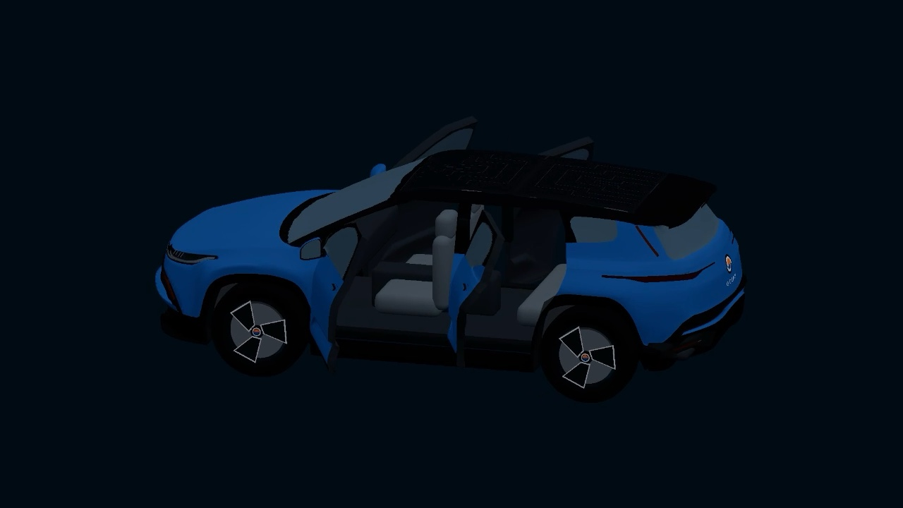

# Fisker Ocean 3D Model

**v3.0.0**

A controllable Fisker Ocean model for dashboards, apps, websites and real-time 3D projects. It includes standard and lightweight GLB files, an editable Blender scene, a ready-to-open interactive viewer and integration notes for developers and their choice of LLM.

[Watch the 30-second MP4 showcase](media/showcase.mp4) for a quick demonstration of the doors, retracting handles, wheels, lighting and solar roof. It is one continuous shot without labels, ending in Great White.



## Try the preview

### Open it directly — no build or installation

1. Download and extract the **whole release ZIP** so its folders stay together.
2. Open the root **`index.html`** in a current browser with WebGL 2 support.
3. In **Preview options**, choose **Open local GLB model**.
4. Select **`models/ocean.glb`**, or **`models/ocean-lite.glb`** for the lighter variant.
5. Use the controls to explore the car. Drag to orbit and scroll/pinch to zoom.

The local file picker reads the model on your device; the viewer does not upload it. Browsers restrict automatic file loading from `file://`, so choosing the GLB is intentional. The supplied GLBs contain their presets and control metadata; no separate JSON upload is needed for this route. To switch between standard and lightweight models in this mode, use the local file picker again; the automatic Model detail selector is available when served over HTTP.

### Serve the folder locally — model loads automatically

With Python 3 installed, open a terminal in this folder and run:

```sh
python3 -m http.server 8000 --bind 127.0.0.1
```

On Windows, `py -m http.server 8000 --bind 127.0.0.1` is an equivalent option. Open **http://127.0.0.1:8000/** and stop the server with Ctrl+C when finished. The viewer loads the standard GLB and JSON automatically over HTTP. The prebuilt viewer is included; Node/npm is only needed to change or rebuild its source.

## What the model supports

These capabilities are present in the model's named geometry, materials and pivots. An application supplies state and animates them at runtime.

| Model capability | What is included |
| --- | --- |
| Body paint | Isolated paint material, 14 catalogue/announced colour presets and custom RGB colours; dark trim, glass, badges and wheel wells stay separate |
| Wheel choices | F3a SlipStream, F3b SlipStream Black, F5a AirGlider, F5b AirGlider Black, F6 Vortex and F7 AeroStealth; six presets across four geometry families |
| Driving movement | Whole-car yaw, front-wheel steering and independent wheel-roll pivots for forward/reverse movement |
| Front lighting | Dipped lamps, additive brighter high beam and optional feathered spill meshes; optional punctual spotlights start off |
| Rear lighting | Independent tail lamps, brighter brake lamps including the spoiler centre light, and lower-bumper reversing lamps |
| Indicators | Left/right or synchronised hazards across the front bumper, forward mirror casings, D-pillar See Me signals and rear bumper |
| Doors and handles | Four independent opening doors with complete black window frames; all four handles slide out/retract; front mirrors follow their doors |
| Fixed glazing | Windscreen and third side quarter panes remain fixed when doors open |
| Rear hatch | Opening hatch carrying its rear glass, branding, inner taillight portions, spoiler and centre brake light |
| Sunroof | Front section lifts and slides above the fixed rear roof section |
| Solar roof | Two moving/fixed sections share one closed-roof UV atlas and texture so a continuous power-colour gradient can span both |
| Cabin | Simplified front seats, three-seat rear bench, lining and cargo floor for readable open states |
| Asset variants | Standard and lightweight GLBs with the same controls, plus editable Blender source |

Lamp **glow**, exposure, shadows and a visible lighting environment are renderer features. The GLB supplies emissive materials and optional spill geometry; it does not impose a bloom effect on every engine. There are no baked driving/opening animation clips or automatic vehicle-data connections.

## What the interactive preview adds

These are viewer conveniences, separate from the model itself:

- Orbit/zoom, reset, and rear, rear square-on, front, side, roof, wheel-detail and mirror-detail camera views.
- Paint swatches, custom colour input and all six wheel selections.
- Independent front/tail/high/brake/indicator/reverse controls, All lights and Lights off.
- An unlocked/handle toggle, individual opening sliders, Open all and Close all.
- Solar intensity and gradient-colour controls.
- Car-angle, front-wheel steering and speed sliders; a simulated driving demo.
- Switchable bloom and headlight spill, standard/lightweight selection, GLB download links and local-file loading.
- Soft, restrained lighting and a dark dashboard-style background.

The preview uses **simulated values**, not live telemetry. Its panels, gestures, camera buttons and demo are not automatically added to an app that imports the GLB. The showcase camera choreography is a video demonstration, not a baked model animation.

## Integrate it into a project

Start with [docs/INTEGRATION.md](docs/INTEGRATION.md), then choose a platform guide:

| Environment | Guide |
| --- | --- |
| Web, Three.js, browser apps, Electron/Tauri | [Web and desktop web](docs/platforms/WEB.md) |
| Native Android and Filament | [Android](docs/platforms/ANDROID.md), [Filament binding](docs/platforms/ANDROID_FILAMENT.md), [board checks](docs/platforms/ANDROID_HARDWARE.md) |
| Unity | [Unity](docs/platforms/UNITY.md) |
| Unreal Engine | [Unreal](docs/platforms/UNREAL.md) |
| iOS, macOS and visionOS | [Apple platforms](docs/platforms/APPLE.md) |
| Flutter and React Native | [Cross-platform mobile](docs/platforms/CROSS_PLATFORM.md) |
| Qt Quick 3D / embedded desktop | [Qt](docs/platforms/QT.md) |

For an LLM-assisted integration, give the assistant this entire folder and your application's source, then ask it to read **[AGENTS.md](AGENTS.md)**. The instructions are generic to the developer's choice of assistant and renderer. The Kotlin controllers are reference logic; each environment still needs a renderer adapter and real application-state bindings. Only the browser viewer is a ready-to-run application here.

## Folder map

| Path | Purpose |
| --- | --- |
| `index.html`, `preview/` | Ready-to-run viewer, its editable source and bundled JavaScript |
| `models/` | Standard/lite GLBs and editable `.blend` source |
| `model-contract.json` | Names, axes, pivots, lighting and presentation contract |
| `wheel-options.json`, `paint-presets.json` | Wheel IDs and colour/material presets |
| `runtime/kotlin/` | Renderer-independent driving/lighting and opening/handle controllers |
| `docs/` | Shared integration contract, platform guidance and references |
| `media/` | MP4 showcase and poster |
| `scripts/`, `tests/`, `validation/` | Build/check tooling, Kotlin smoke tests and recorded asset evidence |
| `LICENSE.md`, `ATTRIBUTION.md`, `LICENSES/` | Licence scopes, credits and full licence texts |

## Development and validation

With Node.js/npm installed:

```sh
npm ci
npm run build
npm test
npm run validate
```

`build` regenerates `preview/app.js`. `test` checks release metadata and required model bindings. `validate` runs the Khronos glTF validator and records its report. See [tests/README.md](tests/README.md) for the optional Kotlin logic checks and [docs/VALIDATION.md](docs/VALIDATION.md) for the verification limits.

Release **v3.0.0** uses runtime contract/schema **2.0**. These are different version numbers: the public release is new, while the existing runtime bindings remain compatible. The earlier 2.x development packages are not public GitHub releases. See [CHANGELOG.md](CHANGELOG.md).

## Licence and credits

Model assets, model data, media and project prose: **CC BY 4.0**. Project software: **MIT**. Preserve third-party notices. See [LICENSE.md](LICENSE.md) for the precise file scopes and [ATTRIBUTION.md](ATTRIBUTION.md) for downstream credits.

Based on **Fisker Ocean (low-poly)** by **LagzDesign**, [original model](https://sketchfab.com/3d-models/fisker-ocean-low-poly-f506bfe876864c04b68bdfc59070739a), [CC BY 4.0](https://creativecommons.org/licenses/by/4.0/). This is an unofficial, modified visual interpretation, not manufacturer CAD. Target-device performance and factory dimensional accuracy are not certified.

## Publishing a version

The release workflow runs when VERSION changes on main, or when manually dispatched on main. It validates the committed assets, rebuilds/checks the viewer, packages the exact commit and publishes the matching v-prefixed GitHub release with the ZIP, showcase MP4, both GLBs and checksums. Set the intended version and update RELEASE_NOTES.md before merging a release change. Existing releases are left unchanged. The workflow uses GitHub’s repository-scoped token; no personal token is required.
